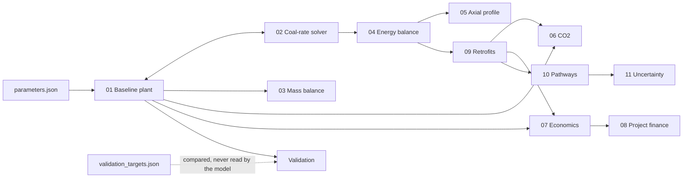

# Models

Model 0.7.1. One document per model, in the order the calculation runs. Each one covers what the model is for, where it lives in the code, its inputs, its method, its result on the reference plant, how it is tested, and what it does not do.

The reference plant throughout is the imported-coal preset at 100 t/day rated capacity, 90% utilisation and 330 operating days, with the coal rate solved from the heat balance. All flows are per tonne of sponge iron (DRI) unless stated.

| # | Model | Code | Question it answers |
|---|---|---|---|
| 01 | [Baseline plant](01_baseline_plant.md) | `src/models/baseline.py` | What goes in and out of the kiln per tonne of DRI? |
| 02 | [Coal and the coal-rate solver](02_coal_and_coal_rate_solver.md) | `src/data/coal.py`, `src/models/plant.py` | How much coal does the kiln need? |
| 03 | [Mass balance](03_mass_balance.md) | `src/models/mass_balance.py` | Does every element close? |
| 04 | [Energy balance](04_energy_balance.md) | `src/models/energy_balance.py` | Where does the coal's heat go? |
| 05 | [Axial kiln profile](05_kiln_axial_profile.md) | `src/kiln/axial.py` | Where along the 80 m kiln does it go? |
| 06 | [CO₂ emissions](06_co2_emissions.md) | `src/emissions/co2_model.py` | How much CO₂ per tonne, and from where? |
| 07 | [Plant economics](07_plant_economics.md) | `src/economics/economics.py` | What does a tonne cost? |
| 08 | [Project finance](08_project_finance.md) | `src/economics/financial.py` | Does a retrofit pay back with a loan and tax? |
| 09 | [Retrofits](retrofits/README.md) | `src/retrofits/` | What does each lever change? |
| 10 | [Pathways and optimisation](10_pathways_and_optimisation.md) | `src/analysis/scenarios.py`, `src/optimization/search.py`, `src/analysis/macc.py` | Which mix reaches a CO₂ target at least cost? |
| 11 | [Uncertainty](11_uncertainty.md) | `src/analysis/sensitivity.py`, `src/analysis/montecarlo.py` | Which inputs move the answer, and by how much? |

Validation against published plant data is described in [`../validation/`](../validation/README.md). Every parameter the models read is listed in [`../parameters/`](../parameters/README.md).

## How the models connect

## Order of calculation

1. `build_plant()` in `src/models/plant.py` refuses a coal analysis that does not sum to 100%, then builds the baseline plant on a basis of 1,000 kg of DRI (model 01).
2. In `coal.rate_mode = "solve"` (the default), the coal rate is bisected until the kiln heat balance closes (model 02). In `"specified"`, the configured rate is used as given.
3. The mass balance audits the stream table, element by element (model 03). The energy balance itemises the coal's heat (model 04), and the axial model places that ledger along the kiln (model 05).
4. CO₂ is counted from the carbon balance at the stack boundary (model 06), and cost per tonne from prices and annualised capital (model 07).
5. `evaluate()` in `src/analysis/scenarios.py` applies retrofits as deltas on the solved plant (model 09). The variable-speed drives go first because they lower the auxiliary load. The coal-cutting levers come next, then waste-heat recovery, so the after-burner heat follows the coal that remains.
6. Each retrofit combination is valued as a financed project (model 08) and searched for the least-cost route to a CO₂ target (model 10). The uncertainty layer reruns all of this across the cited parameter ranges (model 11).

## Two system boundaries

The literature uses two boundaries, and they give different answers, so the models name the one they use.

- **Kiln.** The rotary kiln alone, as in Dey et al. (2015). A large share of the coal's volatile matter leaves unburnt. The energy balance is drawn here, and the unburnt volatiles are labelled as energy sent to the after-burner chamber, not as a loss.
- **Stack.** The kiln plus the after-burner chamber, where those volatiles and CO burn. CO₂ is counted here, and waste-heat recovery claims the after-burner heat back.

## Design rules every model follows

- **No magic numbers.** Every numeric assumption is in `project/config/parameters.json` with a source, a range and a status. Physical constants (molar masses, standard enthalpies) are in `src/data/parameters.py`.
- **Derive, do not assume.** Only independent quantities are configured. Ore rate, air rate, waste-gas composition and coal rate are solved, so they become checkable results.
- **Report residuals.** Both balances print their residual. Nothing is spread across other terms to make a balance look tight.
- **Validation targets are not inputs.** `validation_targets.json` holds the published ranges the outputs are checked against. No model reads it.

## Identity of a result

`src/version.py` holds `MODEL_VERSION`. `build_plant()` and `evaluate()` attach that version and the SHA-256 of `parameters.json`. The reference results are frozen in `project/tests/golden/baseline_100tpd_imported.json`, and the golden test fails if the model drifts from them without a version bump.

## Limits that apply across the models

- The waste-heat boiler and cycle efficiencies are design values from one detailed project report, not a measured boiler test.
- No paper gives a full domestic-coal analysis. The domestic preset is Dey's coal diluted to 30% ash on a dry, ash-free basis.
- Metallisation is an input, not a prediction. A validation pass on metallisation is therefore not evidence.
- Ore is a single pellet-grade feed. Lump-ore operation is not a preset.
- Five parameters still need a citation. They are listed in [`../parameters/data_provenance.md`](../parameters/data_provenance.md).
