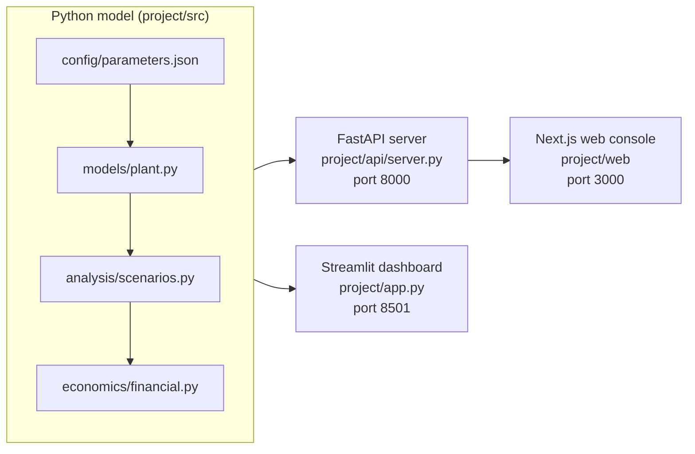

# Software

How the code is laid out, how to run it, and how it is tested.

## Architecture



There are two front ends on one model. Neither one calculates anything; both call the same Python functions.

| Layer | Location | Role |
|---|---|---|
| Model | `project/src/` | Physics, economics, retrofits, analysis. Described in [`../models/`](../models/README.md). |
| Model API | `project/api/server.py` | FastAPI. `GET /api/meta`, `POST /api/scenario`, `POST /api/pathways`, `GET /api/parameters`. Returns the solved plant, balances, retrofits, finance and benchmark checks as JSON. |
| Web console | `project/web/` | Next.js 16, React 19, Tailwind CSS v4, Recharts. The production front end. Requests to `/api/model/*` are proxied to the model API. |
| Streamlit dashboard | `project/app.py`, `project/src/ui/` | The analyst's workbench, with eight tabs including uncertainty, scenario comparison and the grounded analyst chat. |
| Analyst | `project/src/agent/` | Read-only tools and a grounding check that withholds any sentence quoting a number the tools did not return. No language-model API is called. See [`agent_design.md`](agent_design.md). |
| Exports | `project/src/reporting/export.py` | Excel workbook and one-page HTML brief, built from results already computed |

## Source layout

```
project/
├── api/server.py            model API for the web console
├── app.py                   Streamlit dashboard (UI only)
├── config/                  parameters, validation targets, analysis settings
├── data/                    generated provenance CSVs, price series
├── outputs/                 generated validation report
├── setup_data.py            regenerates every generated file
├── run_web.sh               starts the API and the web console together
├── src/
│   ├── data/                parameter store, coal closure, presets, prices
│   ├── models/              baseline plant, coal solver, mass and energy balance
│   ├── kiln/                axial profile
│   ├── emissions/           CO2 from the carbon balance
│   ├── economics/           cost per tonne, financed cash flow
│   ├── retrofits/           one module per lever
│   ├── analysis/            pathways, abatement curve, sensitivity, Monte Carlo
│   ├── optimization/        continuous search
│   ├── validation/          checks against published ranges
│   ├── agent/               analyst tools and grounding
│   ├── reporting/           workbook and brief
│   ├── ui/                  Streamlit theme, charts, components
│   └── version.py           model version and parameter-file hash
├── tests/                   pytest suite, golden baseline, analyst evaluation cases
└── web/                     Next.js console
    ├── app/                 page, layout, global styles
    ├── components/kiln/     dashboard shell, views, charts, schematic, primitives
    └── lib/                 API client and number formatting
```

## Running

All commands run from `project/`. Call the virtual environment's binaries directly; there is no need to activate it.

| Task | Command |
|---|---|
| Web console and model API | `./run_web.sh`, then open http://localhost:3000 |
| Model API alone | `./venv/bin/python -m uvicorn api.server:app --port 8000` |
| Streamlit dashboard | `./venv/bin/streamlit run app.py`, then open http://localhost:8501 |
| Test suite | `./venv/bin/python -m pytest tests/ -q` |
| Validation report | `./venv/bin/python src/validation/literature_check.py` |
| Solved coal rate and closure | `./venv/bin/python src/models/plant.py` |
| Regenerate generated files | `./venv/bin/python setup_data.py` |

`run_web.sh` installs the web console's packages on first run. Set `WEB_PORT` to change the console's port, and `MODEL_API_URL` to point the console at an API on another host.

### Setting up from scratch

```bash
cd project
python3.14 -m venv venv
./venv/bin/pip install -r requirements.txt
cd web && npm install
```

The virtual environment stores absolute paths. If the project folder moves, recreate it with the two commands above rather than activating the old one.

## Keeping it running locally

`run_web.sh` uses development mode. For a copy that stays up, build the console once and run both parts in a `tmux` session, which survives closing the terminal:

```bash
cd project/web && npm run build
tmux new -s dri
cd project && ./venv/bin/python -m uvicorn api.server:app --port 8000 &
cd web && npm start
```

Detach with `Ctrl + B`, then `D`. Reattach with `tmux attach -t dri`.

## Hosting

The model API goes on [Render](https://render.com) and the web console on [Vercel](https://vercel.com). Both have free tiers.

**Model API on Render.** `render.yaml` at the repository root describes the service. In Render, choose **New → Blueprint**, connect the GitHub repository, and accept. It installs `project/requirements-api.txt` (FastAPI and uvicorn only; the plant, retrofit and finance code the API loads needs nothing beyond the standard library), starts uvicorn on Render's port, and uses `/api/meta` as the health check. Note the service URL, for example `https://dri-kiln-api.onrender.com`.

**Web console on Vercel.** **Add New → Project**, import the same repository, and set:

| Setting | Value |
|---|---|
| Root directory | `project/web` |
| Environment variable | `MODEL_API_URL` = the Render URL, with no trailing slash |

The console forwards `/api/model/*` to that URL from Vercel's servers, so no CORS setup is needed. The forwarding rule is fixed at build time: after changing `MODEL_API_URL`, redeploy.

**Cold starts.** Render's free tier sleeps after about 15 minutes without traffic. The first request after that takes 30 to 60 seconds; later ones are fast. Open the site a minute before a demo, or use a paid instance to keep it awake.

**If Render rejects the Python version.** Change `PYTHON_VERSION` in `render.yaml` to the newest 3.14 release Render lists.

**Streamlit dashboard (optional).** Deploy `project/app.py` on [Streamlit Community Cloud](https://streamlit.io/cloud). It uses the full `project/requirements.txt`.

## Tests

190 tests. CI runs them on every push (`.github/workflows/ci.yml`).

| File | Covers |
|---|---|
| `test_model.py` | Balances, stream signs, CO₂ scopes, retrofit direction, cost build-up, provenance |
| `test_hardening.py` | Coal closure, the ash range, cost scaling, the boundary audit |
| `test_kiln.py` | Axial profile |
| `test_process_cases.py` | Oxygen, kiln control, producer gas, char recycling and variable-speed drives against their sources |
| `test_scenarios.py` | Pathway grid, least cost, Pareto front, hydrogen break-even |
| `test_uncertainty.py` | Tornado, Morris, Monte Carlo, abatement curve, continuous search, cited web archives |
| `test_financial.py` | Annuity identity, loan schedule, the BEE 2011 tax arithmetic, price series, saved scenarios |
| `test_financial_robustness.py` | IRR edge cases, tax-loss carry-forward, stress direction, every lever combination |
| `test_agent.py` | Analyst tools are read-only, and answers are grounded |
| `test_ui.py` | Number formatting, palette rules, and that every Streamlit chart builds and conserves the stream table |
| `golden/test_baseline.py` | The reference plant, frozen. Rebuild with `golden/regenerate.py` only after bumping `MODEL_VERSION` and writing the reason in `CHANGELOG.md`. |

## Presentation rules

The chart palette was checked with a data-visualisation validator for lightness, chroma, colour-vision separation and contrast. The aqua and yellow slots carry a contrast warning, so every chart has direct labels and a data-table view. Keep that pairing when adding a chart. Other rules: one y-axis per chart, categorical colours in a fixed order, status colours always paired with an icon or shape.
